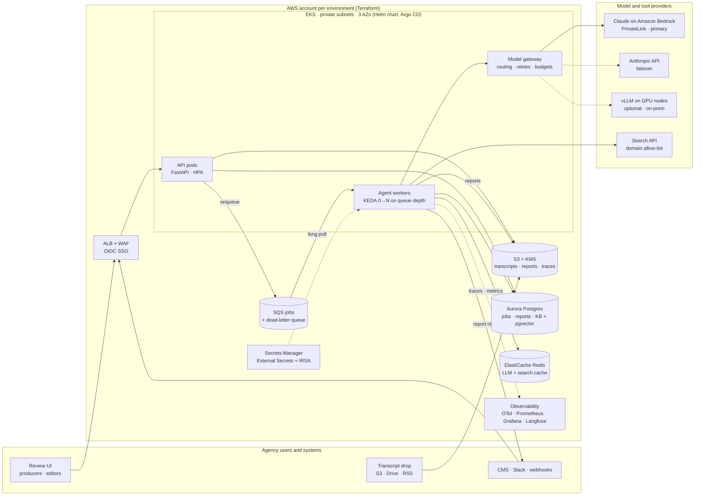

# Deployment strategy

How this agent would run for real at an ad agency: many client brands, bursty episode drops, human editors approving everything before it is published, and confidential pre-release content.

> **What exists in this repo vs. what is proposed.** The agent, CLI, HTTP API, queue worker (`dir://` and SQS adapters), Docker image and a lint-clean Helm chart (`deploy/helm/podcast-agent`) are implemented. Terraform, the model gateway service, the review UI and the managed data stores below are the proposed production design.

---

## 1. Requirements and assumptions

| Area | Assumption | Design consequence |
|---|---|---|
| Users | Producers and editors across many client brands | Multi-tenant: SSO, per-tenant data isolation and budgets |
| Volume | Tens to a few thousand episodes a month, arriving in bursts (season drops) | Queue-based, autoscaling workers that scale to zero |
| Latency | Minutes are fine; nobody waits on a spinner | Asynchronous jobs, not a synchronous request chain |
| Risk | A wrong "fact" in published show notes is a brand problem | Human review gate; confidence routing; full audit trail |
| Data | Transcripts can be confidential until release | Private networking, encryption, no-training model terms, retention limits |
| Integrations | Uploads, storage drops, CMS, Slack | API + object-store triggers in, webhooks out |

## 2. Architecture



A static export of this diagram is in [architecture.svg](architecture.svg) for viewers that don't render Mermaid.

The same view in plain text, for terminals and slides:

```
 Producers/editors ──SSO──► ALB + WAF ──► API pods (FastAPI, HPA) ──► S3 (transcripts, reports, traces · KMS)
 CMS / Slack ◄──── webhooks ─────────────────┐   │ enqueue job (idempotency key)
 S3 / Drive / RSS drop ──► S3 event ─────────┼──►│
                                             │   ▼
                                             │  SQS jobs ──(maxReceiveCount)──► DLQ ──► alert
                                             │   │ long poll
   EKS · private subnets · 3 AZs             │   ▼
   (Helm chart, Argo CD GitOps)        ┌─────┴──────────────────────────────────────────────┐
                                       │ Agent workers × 0..N   (KEDA scales on queue depth) │
                                       │                                                    │
                                       │  plan ─► normalize ─► summarize ┐                  │
                                       │                       notes     ├─► verify claims  │
                                       │                       claims ───┘   (tool loop)    │
                                       └──┬───────────────┬───────────────┬─────────────────┘
                                          │               │               │
                          Model gateway ◄─┘   KB (Aurora  │   Search API ◄┘  (allow-listed domains,
         (routing · retries · budgets · cache)  pgvector) │                    cached in Redis)
             │            │            │                  ▼
     Bedrock (Claude)  Anthropic    vLLM (GPU)     Report → S3 + Postgres → review UI → publish
       primary         failover     on-prem
                                                   OTel traces · Prometheus/Grafana · Langfuse
```

### Life of a job

1. **Ingest.** A producer uploads a transcript, a system posts it to the API, or a file lands in a watched bucket. The raw transcript goes to S3 (KMS-encrypted). A job row is written to Postgres with an idempotency key, the hash of transcript + prompt version + model ids. The job is then queued on SQS.
2. **Execute.** A worker long-polls SQS and runs the agent you see in this repo. It plans, normalizes, summarizes, extracts notes and claims, and verifies each claim in its tool loop. Every LLM call goes through the model gateway.
3. **Persist.** The report (JSON and Markdown) and the reasoning trace are written to S3 and Postgres. `report.json` is written last as the commit marker. Only then is the SQS message deleted (at-least-once delivery).
4. **Review.** Editors see the show notes beside the fact-check table. ⚠️ verdicts, ❓ verdicts on factual claims, and anything under a confidence threshold are routed for attention. Edits and verdict overrides are stored, and they become evaluation data.
5. **Publish.** Approved notes are pushed to the CMS or social scheduler by webhook, and Slack gets a "ready for review" notice.

## 3. Deployment and release

| Concern | Approach |
|---|---|
| Packaging | One image, three entrypoints (`run`, `serve`, `worker`). Multi-stage build, non-root user (uid 10001), read-only root filesystem. Trivy scan, SBOM and cosign signature in CI; pushed to ECR. |
| Infrastructure as code | Terraform modules for VPC (3 AZs, private subnets, VPC endpoints for S3, SQS and Bedrock), EKS with managed node groups, Aurora Postgres, SQS + DLQ, S3, KMS, IAM roles for service accounts. Separate state and account per environment. |
| Kubernetes | `deploy/helm/podcast-agent`: API Deployment + Service + HPA + PDB; worker Deployment with a KEDA `ScaledObject` on SQS depth (scale to zero); ConfigMap for non-secret config; `ExternalSecret` from Secrets Manager; NetworkPolicy (DNS + HTTPS egress only); zone spread; config-checksum rollouts. |
| Environments | `values.yaml` holds shared defaults; `values-dev.yaml` (offline provider, no cloud dependencies, runs on kind) and `values-prod.yaml` (External Secrets, KEDA, OpenTelemetry at 25% sampling, PrometheusRule alerts) override them. `values.schema.json` rejects unknown keys and bad values at `helm template` time, and CI renders every environment and validates the manifests and CRDs with kubeconform. Images are pinned by digest per environment. |
| Delivery | GitOps with Argo CD: one Application per environment, promotion dev → staging → prod by pull request. Argo Rollouts canary for the API, with automatic rollback on error-rate or latency regression. |
| Model and prompt changes | Prompts live in `prompts.py` with a `PROMPT_VERSION`. Model ids are pinned in config. A prompt or model change runs the evaluation suite in CI and must pass blocking thresholds before merge. It then ships behind a config flag and is shadow-run on a sample of live jobs. |
| Configuration | Twelve-factor: everything is an environment variable (`.env.example` lists them); secrets never live in the image or chart values. |
| Self-hosted installs | The same chart installs into a customer's own cluster (EKS, AKS, GKE, OKE or on-prem) with `LLM_PROVIDER=ollama`/vLLM and search disabled or internal. That is the shape of a SeekrFlow-style private deployment. |

## 4. Cost

LLM spend is driven by tokens. List prices checked on 2026-10-13: Claude Sonnet 5.5 is $2 / $10 per million input / output tokens, Haiku 5.5 is $0.10 / $0.50, Sonnet cache reads cost 0.05× input, and the Batch API halves prices. The worked example below is a 60-minute episode: about 9,000 words, about 12,000 transcript tokens and 10 claims.

| Step | Model | Input tokens | Output tokens | Cost |
|---|---|---|---|---|
| Plan | Haiku 5.5 | ~0.8k | ~0.2k | ~$0.0002 |
| Summarize | Sonnet 5.5 | ~12.3k (transcript written to prompt cache) | ~0.45k | ~$0.035 |
| Key notes | Sonnet 5.5 | ~12.3k (transcript read from cache) | ~0.8k | ~$0.010 |
| Claim extraction | Haiku 5.5 | ~12.5k | ~1.2k | ~$0.002 |
| Verification (10 claims × ~3 turns) | Sonnet 5.5 | ~40k | ~4.5k | ~$0.125 |
| **Total per episode** | | **~78k** | **~7k** | **≈ $0.17** |

Every run records actual token usage per step in `run_manifest.json`, so these estimates can be replaced with measured numbers after a pilot. Verification dominates the bill, which points to the cost levers in priority order:

1. **Tiered verification.** Run the claim loop on Haiku and escalate to Sonnet only for ⚠️ or low-confidence verdicts. If about 30% escalate, verification drops from ~$0.125 to ~$0.04 per episode and the total to ~$0.09.
2. **Batch API for backlog.** Archive back-catalogues and non-urgent jobs through the Message Batches API at 50% off.
3. **Prompt caching** (implemented). The transcript prefix is marked cacheable, so notes and claims reuse it. This matters most for long episodes.
4. **Response and search caching** (implemented for LLM responses). Re-running an episode costs nothing, and a redelivered job replays its finished steps from cache. In production the cache moves to Redis so all workers share it.
5. **Planner budgets.** The planner sizes the claim budget to the transcript, and every claim has a tool-call cap.
6. **Gateway budgets.** Per-tenant monthly token budgets with alerts at 80% and a hard stop or downgrade at 100%.
7. **Episode budgets** (implemented). `COST_BUDGET_USD` caps each episode at list prices. Over it, `warn` mode raises `PodcastAgentCostBudgetExceeded` and `enforce` mode stops checking claims. A canary episode every minute catches a costlier deploy before a customer's episode does ([runbook](runbooks/cost-budget.md)).

**Fixed infrastructure costs more than tokens at agency scale.** At 500 episodes a month LLM spend is under $100. An EKS control plane, NAT gateways, Aurora and two or three nodes cost more than that. So the footprint should follow the client (section 8): a small agency gets the serverless or single-VM option; Kubernetes is for multi-tenant, enterprise or self-hosted needs. Workers are stateless and idempotent, so they can run on Spot capacity and scale to zero between drops.

## 5. Scalability

- **Horizontal workers.** Workers are stateless. KEDA adds replicas as SQS depth grows (2 messages per replica by default) and scales to zero when idle.
- **The real ceiling is the model provider's rate limit.** The gateway enforces per-model token-per-minute and request-per-minute buckets. Separate priority queues keep a rush job from waiting behind a 300-episode backfill. `worker.keda.maxReplicas` is set below the provider quota so the cluster cannot outrun it.
- **Parallelism inside an episode.** Summary, notes and claims depend only on the normalized transcript, so they can run concurrently. Claims fan out with bounded concurrency (for example 4 at a time). This repo runs them sequentially to keep the reasoning log readable; the step graph already encodes the dependencies.
- **Long transcripts.** Single-pass with prompt caching up to `MAP_REDUCE_THRESHOLD_WORDS` (15,000 words, about 1.5–2 hours); beyond that the planner switches to map-reduce summarization (implemented).
- **Data tier.** Aurora with read replicas for the review UI, pgvector for hybrid knowledge-base retrieval, and S3 for every blob, so Postgres stays small.

## 6. Fault tolerance

| Failure | Handling | Status |
|---|---|---|
| Model returns malformed or invalid output | Schema + business-rule validation, error fed back to the model, up to 3 attempts; accepted with a warning or a deterministic fallback | Implemented |
| Planner fails | Deterministic fallback plan; the validator repairs missing or misordered steps | Implemented |
| Provider 429 / 5xx / timeout | SDK retries with exponential backoff; gateway fails over Bedrock → Anthropic API → self-hosted model with a circuit breaker | Retries implemented; failover proposed |
| Search outage | Retried with backoff, then reported to the agent as an observation; it falls back to the knowledge base and lowers confidence | Implemented (`MOCK_SEARCH_FAILURE_RATE` to demo) |
| One step fails | Isolated: dependents are skipped, independent steps still run, and the report is produced with warnings | Implemented |
| Worker crash or pod eviction | Message not deleted → redelivered after the visibility timeout; SIGTERM drains the current job | Implemented (worker) |
| Duplicate delivery | Idempotency key; finished jobs are acknowledged without new LLM spend | Implemented (worker) |
| Poison message | Invalid input dead-letters immediately; transient failures after `maxReceiveCount`; DLQ alarm | Implemented (dir queue); SQS redrive proposed |
| Agent runaway | Tool budget per claim, turn cap, default ❓ for human review; per-job token budget at the gateway | Loop caps implemented |
| Zone or region loss | Multi-AZ EKS and Aurora; S3 cross-region replication and Aurora snapshots for disaster recovery | Proposed |
| Quality failure (hallucination) | Verbatim quote checks, evidence-id validation, confidence caps, human review before publishing | Implemented + process |

## 7. Security, privacy, observability and quality

**Security and privacy**
- SSO (OIDC) with roles for producer, editor and admin. Tenant isolation through Postgres row-level security, per-tenant S3 prefixes and KMS keys, and a dedicated deployment for sensitive clients.
- Private subnets only. Claude is reached through a Bedrock VPC endpoint (PrivateLink), so transcripts do not cross the public internet. Model terms exclude training on customer data.
- No static credentials: IRSA for AWS access, External Secrets for API keys, and a read-only root filesystem.
- Prompt-injection posture: transcripts and web pages are data, not instructions. The agent's tools are read-only and allow-listed, so a malicious page can at worst sway a verdict, which a human reviews. It cannot trigger an action.
- Optional PII redaction before model calls, retention limits (for example, delete transcripts 90 days after publication) and an audit log of who approved what.

**Observability**
- The reasoning trace (`trace.jsonl`) already carries `run_id`, `episode_id`, `step` and `kind`. In production each record becomes an OpenTelemetry span event: one trace per episode, one span per step, LLM call and tool call. LLM payloads go to Langfuse or Arize Phoenix for inspection.
- Metrics: latency per step, tokens and dollars per episode and tenant, cache hit rate, self-correction rate, quote verbatim rate, tool error rate, verdict mix, queue depth and DLQ count.
- Example SLOs: 99% of jobs complete without manual intervention; p95 end-to-end under 5 minutes for a 60-minute episode; alerts on error-budget burn.

**Quality and evaluation**
- A golden set of labeled transcripts and claims runs in CI on every prompt or model change. Deterministic checks run alongside a fact-check accuracy score against labels.
  - Deterministic checks: summary length, exactly 5 takeaways, quotes 100% verbatim.
  - Fact-check accuracy is reported per verdict class.
- Editor overrides from the review UI feed the golden set, and drift in the verdict mix or self-correction rate triggers review.

## 8. Choosing a footprint

| Footprint | When | Shape |
|---|---|---|
| Single VM | Pilot, one team | `docker compose` from this repo, a cron or `worker` against a `dir://` queue on attached storage |
| Serverless AWS | Low ops, spiky volume | API Gateway + Lambda for ingest, SQS, ECS Fargate tasks running `worker`, S3, Aurora Serverless |
| Cloudflare | Global edge, minimal ops | Workers for the API, Queues, Workflows for durable steps, R2, D1, AI Gateway for caching and failover; the agent runs in Cloudflare Containers or is ported to TypeScript |
| Kubernetes (reference above) | Multi-tenant enterprise, existing platform team | EKS, AKS, GKE or OKE + this Helm chart + Argo CD |
| Self-hosted / air-gapped | Regulated or confidential clients | Same chart; open-weight model on vLLM GPU nodes; internal knowledge base; external search disabled |

## 9. Rollout sequence

1. **Pilot.** Single container, one client, 100% human review; build the golden set from editor feedback.
2. **Harden.** Queue + workers, gateway with failover, tracing and dashboards, evaluation gate in CI.
3. **Scale out.** Multi-tenant SSO, per-tenant budgets, KEDA autoscaling, Bedrock primary with Anthropic API failover, shared Redis cache.
4. **Expand.** Real search with domain allow-lists, per-client brand fact bases in pgvector, CMS and social integrations, auto-approval of fully verified, high-confidence notes where the client allows it.

## 10. Handling changing requirements

| New requirement | Change |
|---|---|
| A new output (chapters, SEO blurb, ad-read detection) | Add a step to the catalog and registry; the planner can schedule it, and the validator enforces it if required |
| Audio instead of transcripts | Add a speech-to-text step before `normalize_transcript` (Whisper, AssemblyAI or a Bedrock-hosted model) |
| A different model or vendor | Configuration only (`LLM_PROVIDER`, model ids); the provider interface is vendor-neutral |
| Stricter fact-checking | Require knowledge base + web agreement for ✅, lower the ❓ cap, raise the tool budget, or route every ⚠️ to legal review |
| Client-specific facts (product names, pricing) | A per-tenant knowledge base collection; the verifier already prefers the knowledge base over the web |
| Other languages | Language detection in the profile; prompts take a language parameter; the length validator counts per language |
